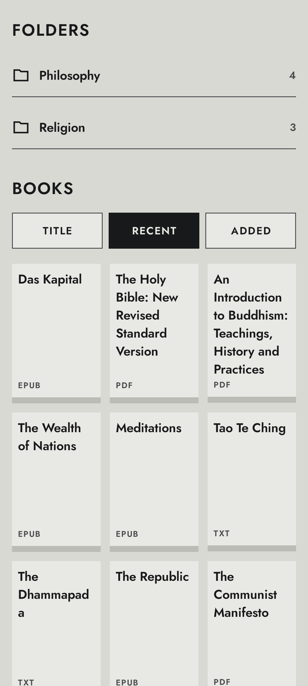
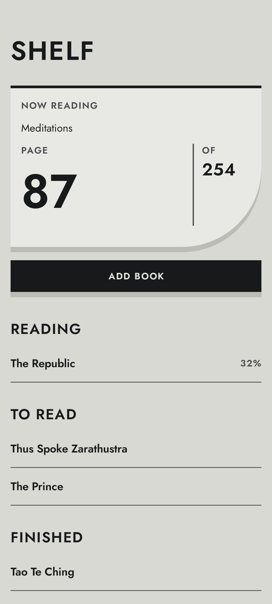
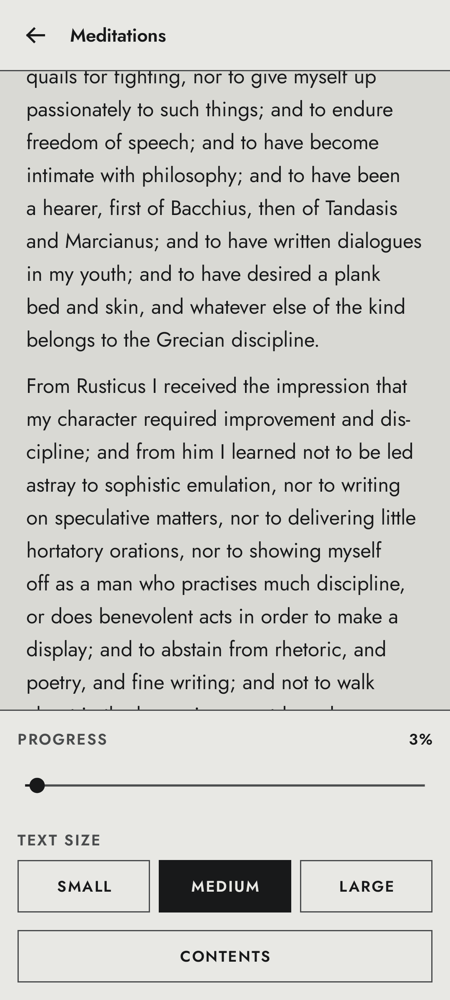

# 293 Reader

An offline Android ebook reader and paper book tracker.

- **Fully offline.** No network permission, no analytics, no crash reporting.
- **Encrypted by default.** Books, covers and the database are encrypted at rest, keys held in Android Keystore.
- **Locked folders.** Protect any folder, or the whole app, with a PIN, passphrase or fingerprint.
- **Reads** PDF, EPUB, TXT and comics (CBZ, CB7), including right-to-left manga.
- **Tracks paper books** alongside ebooks, with one shared reading log.

<table>
  <tr>
    <td align="center"><a href="docs/screenshots/library.png"></a><br>Library</td>
    <td align="center"><a href="docs/screenshots/shelf.png"></a><br>Shelf</td>
    <td align="center"><a href="docs/screenshots/reader-controls.png"></a><br>Reader</td>
  </tr>
</table>

## Install

Download the APK from [Releases](../../releases) and install it. Android will ask you to allow installs from that source the first time. Builds are self-signed and only published here.

## Supported formats

| Format | Notes |
|---|---|
| PDF | Password-protected PDFs must have the password removed first |
| EPUB | EPUB 2 and 3. DRM-protected books are refused |
| TXT | UTF-8, UTF-16 (with BOM) or Windows-1252. Max 16 MB |
| CBZ, CB7 | Comic archives. Manga marked right-to-left in ComicInfo.xml opens that way |
| CBR | Not supported. Convert to CBZ |

## Library

- **Import** several files at once from the system file picker. Files are copied into the app and encrypted on the way in. Duplicates are skipped. Import keeps running if you leave the screen.
- **Folders** nest as deep as you like. Long press a folder or book for its actions.
- **Sort** by title, last opened or date added.
- **Search** by title or author. Ignores case and accents ("brucke" finds "Brücke").
- **Covers** are pulled from the first page (PDF, comics) or the book's cover image (EPUB). Books without one show the title and format.

## Reading

**All formats**
- Swipe or tap the left/right third of the screen to turn the page. Tap the middle for controls.
- Your place is saved automatically and the book reopens where you left off.
- Any sitting of 30 seconds or more is added to the reading log.

**PDF and comics**
- Pinch or double-tap to zoom, up to 5x.
- One page, two-page spreads, or Auto (two in landscape).
- Right-to-left mode per book.

**EPUB and TXT**
- Text is reflowed to fit your screen, in three sizes: Small, Medium, Large.
- Table of contents and in-book links work. Links to the web do not, since the app is offline.
- TXT files are split into chapters automatically from lines like "Chapter 12".

## Shelf (paper books)

- Add a book by hand with title, author and page count (author and page count optional).
- Books are grouped into To read, Reading, Finished and Set aside.
- Tap **Log reading** to record pages and minutes. Your bookmark moves forward, and reaching the last page marks the book finished.

## Reading log

- One list for ebooks and paper books, newest first, grouped by day.
- Shows hours read today and this week.
- Books in locked folders never show up here.

## Locked folders and app lock

**Lock a folder:** long press it and choose **Lock**. Use a PIN (6+ digits) or a passphrase (8+ characters). A passphrase is stronger and recommended. Fingerprint unlock can be added on top.

**Lock the whole app:** Settings > Locks.

**What a locked folder hides:** titles, authors, covers, subfolder names and the books themselves. While closed, you can still see how many books it holds and their sizes. Locked books never appear in search or the reading log.

**When it closes:** when you tap Lock now, when the screen turns off, or after the app sits in the background for the chosen time (immediately, 1, 5 or 15 minutes; default 1).

**Wrong guesses:** four are free, then you wait 30 seconds, doubling each time up to an hour. Nothing is ever wiped.

> [!WARNING]
> There is no password recovery. If you forget the PIN or passphrase, the books in that folder (or the whole library, for the app lock) cannot be opened again. Clearing the app's storage in Android settings is the only way to start over.

<details>
<summary><b>Security details</b></summary>

- **Files:** Tink StreamingAead (AES256_GCM_HKDF_1MB), keyset wrapped by an Android Keystore master key. Stored in no-backup storage under random names, with the file name bound as associated data. Reads are seekable, so decrypted content is never written to disk. PDFs are rendered from a memfd.
- **Database:** Room on SQLCipher with a random 256-bit passphrase wrapped by a Keystore-backed AEAD. Uses `secure_delete` and truncates the WAL after sealing.
- **Backups:** disabled. Keystore keys cannot leave the device, so a backup would be unreadable anyway.
- **Locked folders:** each has its own Tink keysets, wrapped twice: under an Argon2id key derived from the secret (Bouncy Castle; 64 MiB, 3 passes, 1 lane, random salt, parameters bound as AD), then under a non-exportable Keystore AES-GCM key unique to that folder. Fingerprint unlock is a separate wrap under a strong-biometric Keystore key that is invalidated when a fingerprint is added. Sealed values are bound to their row. Changing the secret re-wraps the keysets only.
- **Lock/unlock** re-encrypts every book and cover under the new key. Each book switches in one step, so a crash leaves everything readable and the work resumes on next start.
- **App lock:** database passphrase and file keyset are wrapped the same way and their Keystore-only copies deleted. Locking ends the process.
- **Rate limit:** survives restarts and clock changes.
- **Screenshots:** locked content and unlock screens are excluded from screenshots and recents. Settings can block screenshots app-wide (off by default).
- **Known limits:** a PIN has a small key space and could be brute-forced offline by someone with the app data and the phone's Keystore. Flash storage may retain old blocks. Java strings and Tink keys can't be zeroed in memory. Android may delay the background lock timer, but the app locks before showing anything when it returns. Duplicate detection doesn't see books in locked folders.

</details>

## Building

Requires JDK 17+ and Android SDK platform 37.

```bash
./gradlew assembleDebug                 # debug APK
./gradlew testDebugUnitTest             # JVM unit tests (Android modules)
./gradlew :core:model:test              # JVM unit tests (pure Kotlin module)
./gradlew connectedDebugAndroidTest     # instrumented tests, needs a device or emulator
```

README screenshots are Roborazzi tests with fake data (needs JDK 21+). `./gradlew recordRoborazziDebug` re-records them, `./gradlew verifyRoborazziDebug` checks them.

<details>
<summary><b>Release signing</b></summary>

1. Create a keystore: `keytool -genkeypair -v -keystore release.jks -keyalg RSA -keysize 4096 -validity 10000 -alias [alias]`
2. Copy `keystore.properties.example` to `keystore.properties` and fill in the `[bracketed]` values. Both files are gitignored; never commit them.
3. `./gradlew assembleRelease`

Without `keystore.properties`, the release build produces an unsigned APK.

</details>

<details>
<summary><b>Project layout</b></summary>

```
build-logic/        convention plugins (android, compose, feature, hilt, room, jvm, screenshots)
app/                application, activity, navigation shell, signing
core/model          pure Kotlin domain types
core/designsystem   design tokens and 293 components (only place tokens live)
core/security       Keystore/Tink keys, file encryption, Argon2id wraps, folder keyring, app lock
core/database       Room on SQLCipher, schema exports in schemas/
core/data           repositories and settings
core/screenshots    shared Roborazzi setup (test-only)
reader/api          format-neutral reader contract, bitmap pool
reader/archive      zip and 7z over a decrypting channel
reader/pdf          PdfRenderer
reader/comic        CBZ and CB7
reader/epub         EPUB 2 and 3 parsing
reader/txt          encoding detection, paragraphs, chapters
feature/*           library, reader, physical (shelf), log, settings, lock
```

New formats (MOBI, AZW3, FB2) can be added as modules behind `reader:api`. CBR is out because the only non-GPL JVM RAR reader covers RAR4 only and isn't OSI-licensed.

</details>

<details>
<summary><b>Design system</b></summary>

The UI follows the 293 design system: `design/293-design-system.md` (rules) and `design/293-tokens.json` (values). All tokens live in `core:designsystem`; no other module hardcodes a colour, size or text style. `ColorTokensTest` fails if the Kotlin colours drift from the JSON. Previews for all four themes are in `ComponentPreviews.kt`.

</details>

## License

293 Free Use License v1.0. See `LICENSE` and `AI-NOTICE.md`. Third-party licenses are in `THIRD_PARTY_NOTICES.md`.
